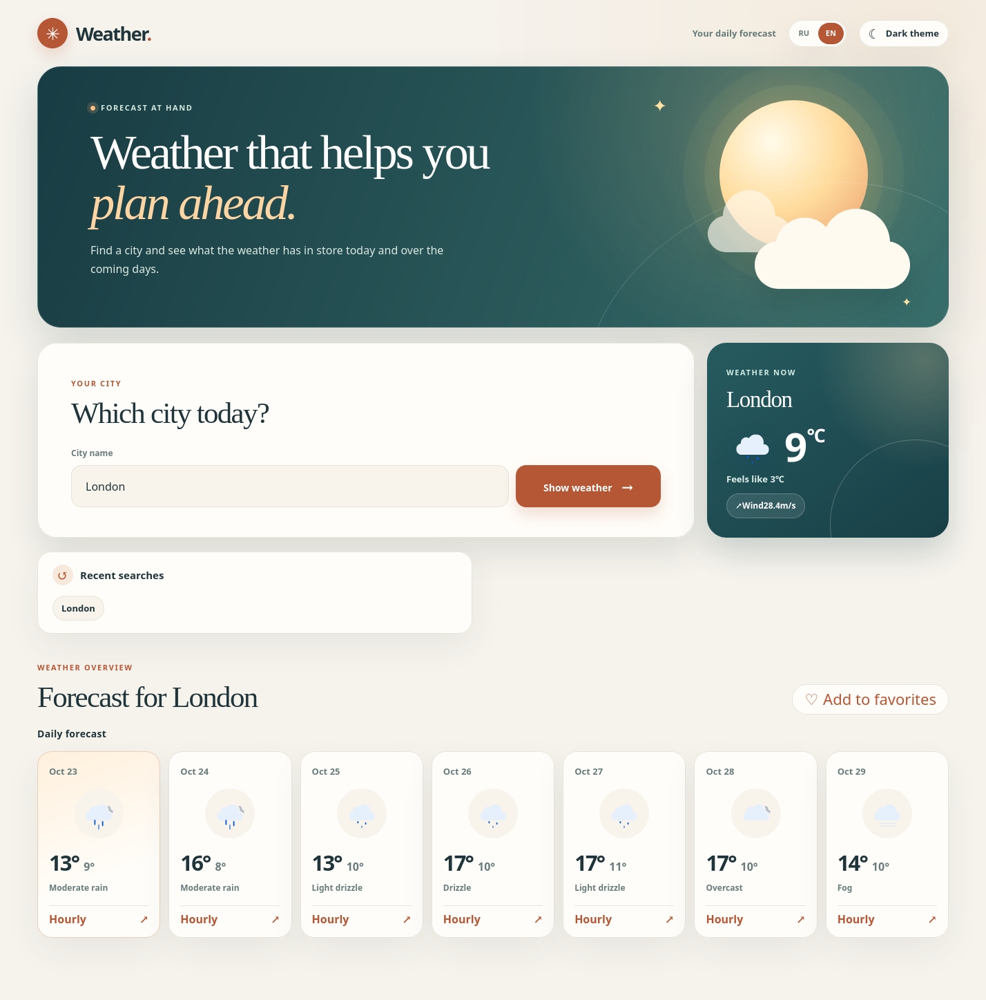
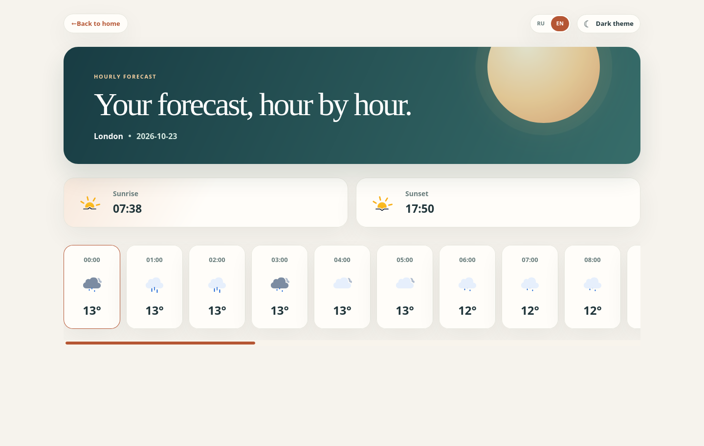

# Weather Dashboard

[](https://github.com/jabrail059/weather-dashboard/actions/workflows/check.yml)
[](https://github.com/jabrail059/weather-dashboard/actions/workflows/build.yml)
[](https://go.dev/)

A server-rendered weather dashboard built with Go, HTMX, PostgreSQL, and Redis. It shows current conditions, a seven-day forecast, and hourly weather for a selected day. The interface supports English and Russian, plus light and dark themes.

## Screenshots

The screenshots show the English interface with a forecast for London.

### Dashboard



### Hourly forecast



## Features

- Search for a city and view current conditions and a seven-day forecast
- Open an hourly forecast for any day in the forecast
- Save favorite cities and revisit recent searches
- Show a suggested city when IP geolocation is available
- Switch between English and Russian, and between light and dark themes

## Stack and architecture

| Area | Implementation |
| --- | --- |
| Backend | Go 1.25.6, `net/http` |
| UI | Go HTML templates, HTMX, CSS, JavaScript |
| Weather and geocoding | Open-Meteo |
| Suggested city | ip-api |
| Persistent data | PostgreSQL (cities and favorites) |
| Cache and recent searches | Redis |
| Deployment | Docker Compose |
| CI | GitHub Actions, golangci-lint, `go test`, Docker build |

The browser requests HTML pages and HTMX fragments from the Go server. Forecast services look up city coordinates in PostgreSQL or Open-Meteo, then use Redis to cache weather responses. Favorites are stored in PostgreSQL, while recent searches are stored in Redis. A cookie associates favorites and search history with a browser session.

```text
Browser (HTML + HTMX)
          │
          ▼
Go HTTP handlers and services
          ├── Open-Meteo and ip-api
          ├── PostgreSQL: cities, favorites
          └── Redis: forecasts, favorites cache, recent searches
```

## Quick start with Docker Compose

Install Docker, Docker Compose, and GNU Make. From the project directory:

```bash
cp .env.example .env
```

Set the required values in `.env`. For a local Compose setup, the blank entries can be filled as follows; choose your own PostgreSQL password:

```env
POSTGRES_USER=dashboard
POSTGRES_PASSWORD=your-password
POSTGRES_DB=weather
REDIS_ADDR=dashboard-redis:6379
REDIS_PASSWORD=
GEOCODING_BASE_URL=https://geocoding-api.open-meteo.com/v1/search
FORECAST_BASE_URL=https://api.open-meteo.com/v1/forecast
IP_API_BASE_URL=http://ip-api.com/json
```

Keep the HTTP settings and other defaults from `.env.example`. Then start the data services, apply the database migration, and build and start the dashboard:

```bash
make env-up
make migrate-up
make dashboard-deploy
```

Open [http://localhost:8081](http://localhost:8081). Use the **EN** button in the header to switch to English; the language and theme choices are saved in the browser.

Check the containers with `make ps`. To stop the Compose stack, run:

```bash
PROJECT_ROOT="$PWD" docker compose down
```

PostgreSQL, Redis, and application logs are stored under `out/`. The migration creates the `dashboard.cities` and `dashboard.favorites` tables.

## Local development

Install Go 1.25.6 or newer. Start PostgreSQL and Redis with Compose, apply the migration, and expose their ports on localhost:

```bash
make env-up
make migrate-up
make postgres-port-forward
make redis-port-forward
make dashboard-run
```

`make dashboard-run` loads `.env`, sets the PostgreSQL and Redis hosts to `localhost`, runs `go mod tidy`, and starts `cmd/dashboard/main.go`. The dashboard is available at [http://localhost:8081](http://localhost:8081).

## Makefile commands

| Command | Purpose |
| --- | --- |
| `make env-up` | Start PostgreSQL and Redis |
| `make migrate-up` | Apply database migrations |
| `make dashboard-deploy` | Build and start the dashboard container |
| `make dashboard-run` | Run the dashboard locally with Go |
| `make postgres-port-forward` | Expose PostgreSQL on `127.0.0.1:5432` |
| `make redis-port-forward` | Expose Redis on `127.0.0.1:6379` |
| `make ps` | Show Compose service status |

## Configuration

The application reads these settings from the environment. Docker Compose and the Makefile load `.env` for the commands above.

| Variable | Purpose |
| --- | --- |
| `HTTP_ADDR` | Address for the HTTP server; `.env.example` uses `:8081` |
| `HTTP_SHUTDOWN_TIMEOUT` | Graceful shutdown timeout |
| `HTTP_ALLOWED_ORIGINS` | Allowed origins for CORS |
| `POSTGRES_HOST`, `POSTGRES_PORT` | PostgreSQL host and port; port defaults to `5432` |
| `POSTGRES_USER`, `POSTGRES_PASSWORD`, `POSTGRES_DB` | PostgreSQL credentials and database |
| `POSTGRES_TIMEOUT` | PostgreSQL operation timeout |
| `REDIS_ADDR`, `REDIS_PASSWORD`, `REDIS_DB` | Redis connection settings |
| `GEOCODING_BASE_URL` | Open-Meteo geocoding endpoint |
| `FORECAST_BASE_URL` | Open-Meteo forecast endpoint |
| `IP_API_BASE_URL` | Base URL for IP geolocation |
| `LOGGER_LEVEL`, `LOGGER_FOLDER` | Log level and output folder; the run commands set the folder |
| `TIME_ZONE` | Application time zone; defaults to `UTC` |

## HTTP routes

| Method | Route | Purpose |
| --- | --- | --- |
| `GET` | `/` | Dashboard page |
| `GET` | `/history` | Recent search HTML fragment |
| `GET` | `/api/v1/weather?city=London` | Current weather and seven-day forecast HTML fragment |
| `GET` | `/api/v1/weather/hourly` | Hourly page; requires `date`, `city`, `sunrise`, and `sunset` query parameters |
| `GET` | `/api/v1/favorites` | Favorite cities HTML fragment |
| `POST` | `/api/v1/favorites?city=London` | Add a favorite |
| `DELETE` | `/api/v1/favorites?city=London` | Remove a favorite |

The HTML fragment routes are used by HTMX; use the page controls to request them from a browser.

## Project layout

```text
cmd/dashboard/          Application entry point and Dockerfile
internal/core/          Configuration, HTTP server, logging, shared domain types
internal/features/      Forecast, favorites, and web features
migrations/             PostgreSQL schema migrations
public/templates/       Go HTML templates
public/static/          Styles and weather icons
docs/screenshots/       README screenshots
```

## Checks

```bash
go test ./...
go vet ./...
```

GitHub Actions runs golangci-lint and `go test ./...` on pushes, and builds the Docker image on pushes to `main`.
